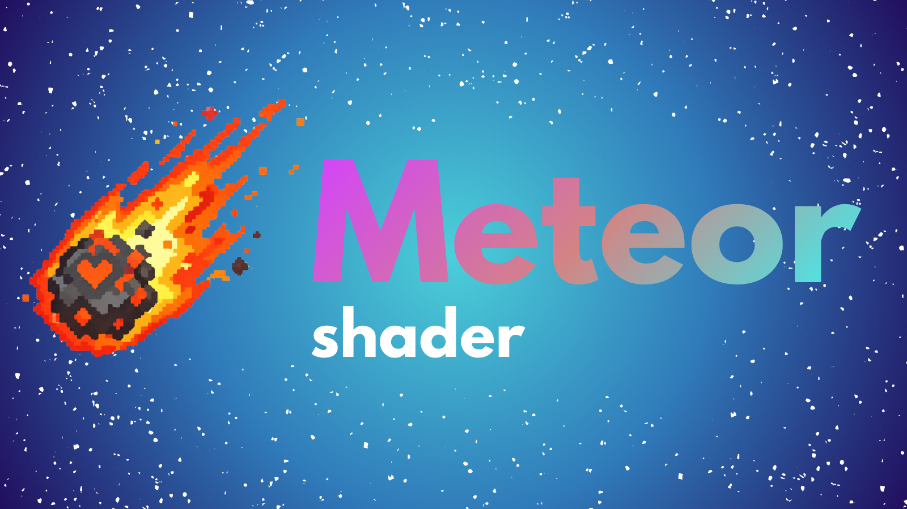

# Meteor Shader

Official shaders built for **Metality Engine** on Apple Silicon Macs (`Minecraft 26.3`).

Includes two editions — pick the one that best fits your Mac:

- **Meteor Dusk** — Lightweight, ultra-fast edition (recommended for `M1` / `M2` or maximum FPS).
- **Meteor Zenith** — Ray-traced edition (hardware ray tracing on `M3`–`M5`, automatic fallback on `M1`–`M2`).

---

## Requirements

- Minecraft `26.3` with [**Metality Engine**](https://github.com/xushiexpresso15/Metality-Engine) (`0.1.0-beta.1` or newer)
- Apple Silicon Mac (`macOS 15.0+`)

---

## Installation

1. Download `meteor-dusk-0.1.0-beta.1.zip` and/or `meteor-zenith-0.1.0-beta.1.zip` from [Releases](https://github.com/xushiexpresso15/Meteor-shader/releases).
2. Place the `.zip` file(s) inside your Minecraft `shaderpacks` folder (or drag & drop them directly into the Minecraft window).
3. Press **`O`** (or open **Video Settings → Shader Packs**) and click **Meteor Dusk** or **Meteor Zenith**.

---

## Profiles

Both editions include four built-in quality presets:
- `LOW` / `MEDIUM` / `HIGH` / `ULTRA`

---

## License

[Apache-2.0](LICENSE)
